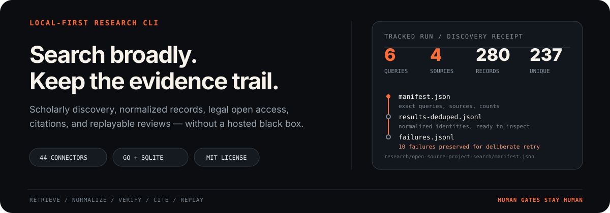
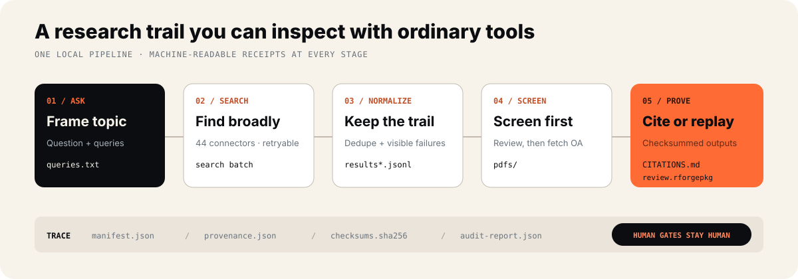

# ResearchForge

<p align="center">
  
</p>

<p align="center">
  <a href="https://github.com/TrebuchetDynamics/research-forge/releases/latest"></a>
  <a href="https://github.com/TrebuchetDynamics/research-forge/actions/workflows/ci.yml"></a>
  <a href="https://github.com/TrebuchetDynamics/research-forge/actions/workflows/playwright-e2e.yml"></a>
  <a href="https://pkg.go.dev/github.com/TrebuchetDynamics/research-forge"></a>
  <a href="./LICENSE"></a>
</p>

<p align="center">
  <a href="#quick-start">Quick start</a> ·
  <a href="#choose-your-workflow">Choose a workflow</a> ·
  <a href="#source-coverage">Sources</a> ·
  <a href="#use-it-from-an-agent">Agent skill</a> ·
  <a href="#trust-boundaries">Trust</a>
</p>

**ResearchForge** is a local-first CLI for literature discovery and reproducible reviews. It searches scholarly sources, normalizes and deduplicates records, keeps failures visible, retrieves legal open-access files, builds citations, and packages attributable work for audit or replay.

Use a **research directory** for fast literature scouting. Use a guided **forge project** when screening, extraction, analysis, and export decisions must be attributable.

## Proof, not promises

A tracked run in this repository used **6 queries across 4 sources** and produced **280 records, 237 deduplicated records, and 10 preserved failures**. Inspect the real [`manifest.json`](./research/open-source-project-search/manifest.json); these are repository artifacts, not adoption or performance claims.

Every batch search leaves an ordinary directory behind:

```text
research/my-topic/
├── manifest.json           # exact queries, sources, counts, timestamp
├── results.jsonl           # normalized records from successful sources
├── results-deduped.jsonl   # merged DOI/title identities
├── failures.jsonl          # retryable source/query failures
├── batch-state.json        # checkpoint for interrupted sweeps
├── search-stats.txt        # coverage and dedupe summary
├── raw/                    # readable source/query responses
└── pdfs/                   # approved open-access downloads
```

Nothing is hidden in a hosted dashboard. Review the JSONL, version it, diff it, retry it, or hand it to another tool.

## Scientific research examples

- [Majorana zero modes — Comprehensive](./research/frontier-science/frontier-20261021-vfs2-live/majorana/report.md): which nanowire signatures distinguish topological modes from trivial alternatives?
- [Nickelates — Standard](./research/frontier-science/frontier-20261021-vfs2-live/nickelates/report.md): which structural conditions and measurements are comparable, and what do they constrain about pairing?

These genuine engine workflows retain host-agent, source-limited scientific
synthesis—not peer review or human scientific approval. The
[examples index](./research/frontier-science/README.md) links evidence, citation
audits, provenance, limitations, and offline inspection / opt-in live reproduction.

## Quick start

### 1. Install

```sh
curl -fsSL \
  https://raw.githubusercontent.com/TrebuchetDynamics/research-forge/main/install.sh | bash
```

One command installs the engine, the public agent skills and the native Claude
Code, Codex, Pi and Hermes integrations for your user account — no `sudo` and no
system-wide changes. Install for the way you work: `--for cli` (just the engine),
`--for skills` (the research skills in your agent), or `--for mcp` (engine plus
typed MCP tools). Select components directly with `--menu` or
`--only binary,skills`, preview with `--dry-run`, and upgrade with
`./install.sh update`. See [installation](./docs/install.md) for components, PATH
handling, Hermes profiles and removal.

Verify the smoke check from any directory, then optionally inspect optional service
setup with `rforge doctor`:

```sh
rforge version
rforge doctor
```

Prebuilt binaries support Linux, macOS, and Windows. To build from source (Go 1.26+):

```sh
go install github.com/TrebuchetDynamics/research-forge/cmd/rforge@latest
```

### 2. Search two reliable starter sources

```sh
rforge search batch --out ./research/my-topic \
  --query "prediction markets information aggregation" \
  --sources openalex,arxiv --stats
```

### 3. Build a bibliography

```sh
rforge citations build --research-dir ./research
```

You now have normalized records, a deduplicated set, a failure queue, a manifest, statistics, and `research/CITATIONS.md`. After title/abstract screening, fetch legal open-access files for included papers:

```sh
rforge oa fetch --dir ./research/my-topic
```

## How the evidence trail works

<p align="center">
  
</p>

ResearchForge automates **reversible work**: retrieval, normalization, deduplication, checkpointing, retry queues, provenance checks, and package audits. Humans still approve inclusion/exclusion, full-text acquisition, accepted extraction, analysis methods, final claims, and package export.

## Choose your workflow

| If you need to…                       | Start here                                               |
| ------------------------------------- | -------------------------------------------------------- |
| Scout a topic quickly                 | `rforge search batch` with `openalex,arxiv`              |
| Maintain a living search              | `search batch --resume`, then `search refresh`           |
| Run an attributable review            | `project create` + `forge init`                          |
| Audit or replay a review package      | `package audit` / `package replay`                       |
| Let an agent research with guardrails | Install the [ResearchForge skill](#use-it-from-an-agent) |

## Keep a topic reproducible

Put one query per line in `queries.txt`, then search several sources in one transaction:

```sh
rforge search batch --out ./research/market-design \
  --queries queries.txt \
  --sources openalex,arxiv,crossref,semantic-scholar \
  --continue-on-error --stats
```

### Resume an interrupted sweep

ResearchForge checkpoints each query/source pair to `batch-state.json`. After a timeout, `Ctrl-C`, or killed process, rerun the same batch with `--resume`:

```sh
rforge search batch --out ./research/market-design \
  --queries queries.txt \
  --sources openalex,arxiv,crossref,semantic-scholar \
  --continue-on-error --stats --resume

rforge search stats --dir ./research/market-design
```

### Retry, refresh, and validate deliberately

```sh
# Preview failed-query retries without using the network
rforge search resume \
  --failures ./research/market-design/failures.jsonl \
  --out ./research/market-design --dry-run

# Replay the stored manifest and report new / unchanged / gone records
rforge search refresh --dir ./research/market-design --dry-run
rforge search refresh --dir ./research/market-design

# Validate a versioned agent-authored receipt
rforge provenance validate ./research/market-design/provenance.json
```

Provenance schema v1 requires an exact depth (`quick`, `standard`, or `comprehensive`), normalized `rforge_version` data, required fields, and string-only errors.

## When a search becomes a review

Create a guided project when decisions and analysis must be replayable by another reviewer:

```sh
rforge project create ./my-review --title "High entropy superconductors"

rforge forge init --project ./my-review \
  --question "What outcomes are reported for high entropy superconductors?"

rforge forge status --project ./my-review
rforge forge next --project ./my-review
```

The state machine covers source planning, import and dedupe, legal acquisition, parser arbitration, screening, evidence extraction, analysis, reporting, privacy review, and export. Review packages include checksums, provenance, redaction records, and offline audit/replay commands:

```sh
rforge package audit  ./review.rforgepkg
rforge package replay ./review.rforgepkg
```

See the [reproducible review package specification](./docs/reproducible-review-package.md) for required files and human gates.

## Resolve, rank, and synthesize

These commands work on what a search already found: they resolve individual papers, decide reading order, and turn one or more topic directories into a brief, an overlap comparison, or a synthesis.

Resolve a specific paper by DOI, arXiv ID, OpenAlex ID, URL, or title. Metadata is merged from OpenAlex, Crossref, arXiv, Semantic Scholar, and Unpaywall, so one lookup returns the OpenAlex ID, arXiv ID, license, and OA status together:

```sh
rforge paper 10.7717/peerj.4375      # DOI
rforge paper 2301.99999              # arXiv ID
rforge paper W123456789              # OpenAlex ID
rforge paper "transformer scaling laws"
rforge paper https://arxiv.org/abs/2301.99999

# Resolve several at once
rforge paper 10.7717/peerj.4375 10.1038/nature14539 "attention is all you need"
rforge paper --file papers.txt --out resolved.json
```

Decide what to read first with `rforge rank`: a citation-weighted, recency-aware, OA-aware score across sources. The score blends log-scaled citation count, recency (1/(1+age)), and an open-access bonus, then prints a numbered list with DOIs and arXiv IDs. Re-rank the same papers through citation-graph prestige when a graph exists:

```sh
rforge rank "mechanistic interpretability sparse autoencoders" \
  --sources openalex,crossref,semantic-scholar --limit 20 --out rank.json

rforge citations expand --source openalex --paper W123456789 --direction both --out graph.json
rforge rank "sparse autoencoders" --graph graph.json
```

Summarize the evidence instead of reading every record. Each output is a Markdown artifact with provenance, so a reviewer can re-run the command and compare:

```sh
# One-page brief from a search directory: summary, top papers, gaps, next steps
rforge brief research/my-topic --out brief.md

# Overlap matrix across two or more search directories
rforge compare research/topic-a research/topic-b --labels "A,B" --out comparison.md

# Cross-topic synthesis: consensus themes, cross-topic papers, open questions
rforge lit --research-dir research --out synthesis/

# Annotations persisted in a project, and recall across past sessions
rforge note add --project <path> --paper <doi> --note "Key result"
rforge history search "PRISMA 2020" --research-dir research --limit 5

# Deterministic replication plan from a resolved paper
rforge replicate 10.1136/bmj.n160 --out replan.md
```

## Source coverage

`search batch` supports **44 connectors**. Start narrow; broad sweeps are slower and more exposed to upstream quotas.

| Preset                            | Good for                                                |
| --------------------------------- | ------------------------------------------------------- |
| `openalex,arxiv`                  | Fast general discovery                                  |
| `scholarly-fast`                  | OpenAlex + arXiv + Crossref                             |
| `openalex,arxiv,semantic-scholar` | Citation-oriented AI/CS research                        |
| `biomedical`                      | PubMed + Europe PMC + bioRxiv                           |
| `preprints`                       | arXiv + bioRxiv + medRxiv + ChemRxiv                    |
| `open`                            | Open-access sources                                     |
| `all`                             | Every keyword-search connector; expect partial failures |

Run `rforge doctor` before a large sweep. It reports optional configuration such as `RFORGE_SEMANTIC_SCHOLAR_API_KEY`, whose absence can cause HTTP 429 responses. For machine-readable command discovery, run `rforge help --json`.

## Use it from an agent

Install the passive **Claude Code, Codex, Pi or Hermes plugin** with the [unified installer](./docs/install.md) (`./install.sh`, or `--only claude` for one host), or follow the per-host commands in the [agent installation guide](./docs/agent-install.md). Hermes uses the self-contained [`hermes-plugin/`](./hermes-plugin/) subdirectory so it does not scan unrelated repository content. The installer moves an old curl-installed `research-forge` skill copy to `<name>.bak` instead of leaving it to shadow the plugin. Plugins do not change host approvals, permissions or schedules.

All hosts expose the same retrieval-first skill at [`skills/research-forge/SKILL.md`](./skills/research-forge/SKILL.md). It defines source breadth, provenance requirements, legal-acquisition boundaries, and human approval gates; it never authorizes an agent to approve screening, extraction, final claims, or package export.

### Standalone MCP (any stdio MCP client)

Install `rforge` using the [quick start](#quick-start), then check server support:

```sh
rforge capabilities --json --require mcp=1
```

Register a local stdio server in your MCP client's configuration:

<details>
<summary>Manual <code>mcpServers</code> entry</summary>

Merge this into the existing configuration rather than replacing it:

```json
{
  "mcpServers": {
    "research-forge": {
      "command": "rforge",
      "args": ["mcp", "serve"]
    }
  }
}
```

</details>

Use an absolute executable path if the client cannot find `rforge` on its `PATH`.
No plugin or project is required. MCP and CLI use the same engine and artifacts:
use MCP for registered typed tools, and CLI for scripts or operations outside the
six-tool MCP surface. See [MCP setup, project paths, and offline smoke verification](./docs/cli.md#mcp-stdio-server).
This is manual registration, independent of plugin-managed setup.

### What the host skill can invoke

The five explicit-only workflows name these engine commands. The skill passes your request through; it never interprets it as shell arguments. Engine operations are documented once in [Resolve, rank, and synthesize](#resolve-rank-and-synthesize).

| Workflow | Command the skill names |
| --- | --- |
| `lit` | `rforge lit --research-dir <dir> --out <dir>` |
| `paper` | `rforge paper <identifier-or-title>` |
| `brief` | `rforge brief <search-dir> --out <brief.md>` |
| `compare` | `rforge compare <dir-a> <dir-b> --out <comparison.md>` |
| `replicate` | `rforge replicate <doi-or-arxiv-id> --out <plan.md>` |

<details>
<summary>Generic fallback — DeepSeek Harness and other shared-agent consumers without native plugins</summary>

```sh
mkdir -p ~/.agents/skills/research-forge
curl -fsSL \
  https://raw.githubusercontent.com/TrebuchetDynamics/research-forge/main/skills/research-forge/SKILL.md \
  > ~/.agents/skills/research-forge/SKILL.md
```

Use your host's documented skill directory if it does not read `~/.agents/skills`. Upgrade the fallback by repeating the download; remove it by deleting only that skill copy. Do not keep it alongside the native plugin in the same host.

</details>

Then ask: **“Use the research-forge skill to research: `<your question>`.”** The skill uses the standalone `rforge` engine through CLI or registered MCP tools; no product fork is required.

## Trust boundaries

- **Open access is explicit.** `oa fetch` distinguishes `oa_unavailable` from download failures; paywall-bypass sources are unsupported.
- **Failures stay visible.** Rate limits, timeouts, and source/query failures remain in `failures.jsonl` for deliberate retry.
- **Research claims remain human-owned.** Retrieval and checks can be automated; scientific approval cannot.
- **Shareable packages are reviewed.** Secrets, private paths, and restricted full text are blocked or redacted before export.
- **Local-first means inspectable.** Core workflows use the CLI and machine-readable files; the Go + HTMX web UI is optional.

## Documentation and development

- [Reproducible review package specification](./docs/reproducible-review-package.md)
- [Product requirements](./RESEARCH-FORGE-PRD.md)
- [Roadmap](./ROADMAP.md)
- [Skill catalog](./SKILLS.md)
- [Contributing guide](./CONTRIBUTING.md)
- [Release downloads](https://github.com/TrebuchetDynamics/research-forge/releases)

```sh
git clone https://github.com/TrebuchetDynamics/research-forge.git
cd research-forge
make check
```

ResearchForge uses Go, SQLite, a Go + HTMX local UI, deterministic fixtures, and test-first development.

## Decision-gated scope

The local Go + HTMX UI is tracked in issue #2 and ADR 0006. The MIT License decision is tracked in issue #1 and [docs/owner-decisions.md](docs/owner-decisions.md).

Run `make todo-audit` to verify owner decisions, `make todo-completion-audit` for the closeout checklist, or `make decisions-markdown` for a blocker table.

## License

[MIT License](./LICENSE) (SPDX: `MIT`) © 2026 Trebuchet Dynamics.
